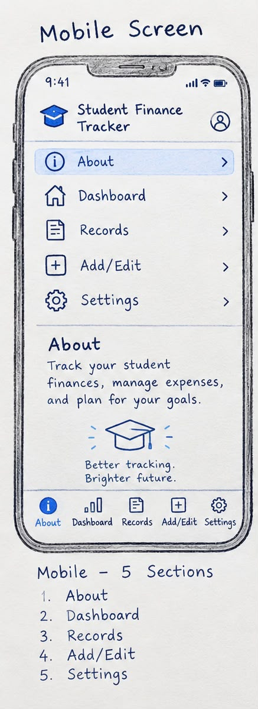
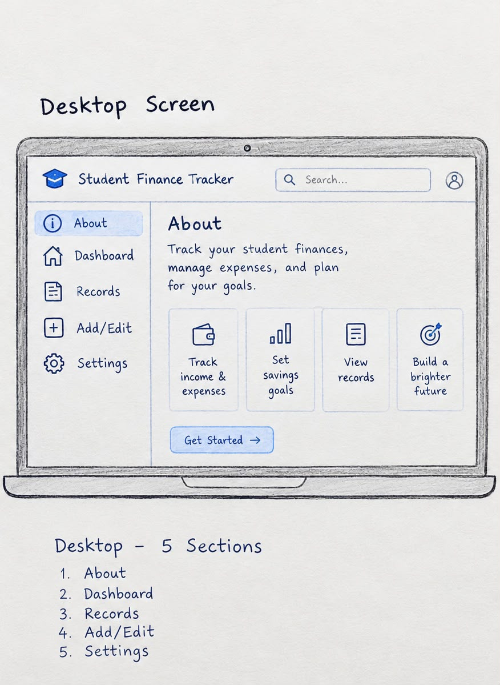

# Student Finance Tracker

**Theme:** Student Finance Tracker
**Live site:** <GitHub Pages URL, add this at deployment>
**Demo video:** <unlisted link, add later>

## About
Student Finance Tracker is a simple application designed to help university students manage their money, track daily expenses, and understand their spending habits. Inspired by student life at the African Leadership University (ALU), it helps students budget wisely, manage their stipends, and make informed financial decisions.

**Contact:** <e.adomanu@alustudent.com> · <https://github.com/acquahhh/>

## Data Model
Each transaction is stored as:

```json
{
  "id": "txn_0001",
  "description": "Lunch at cafeteria",
  "amount": 12.5,
  "category": "Food",
  "date": "2025-09-29",
  "createdAt": "2025-09-29T12:00:00.000Z",
  "updatedAt": "2025-09-29T12:00:00.000Z"
}
```

| Field | Type | Meaning |
|---|---|---|
| id | string | A unique identifier used to distinguish each transaction from others. |
| description | string | A brief explanation of the transaction, such as lunch, rent, transport, or school supplies. |
| amount | number | The monetary value of the transaction. |
| category | string | The spending category assigned to the transaction, such as Food, Housing, Transport, Education, or Other. |
| date | string (YYYY-MM-DD) | The date the transaction occurred, formatted as year-month-day. |
| createdAt / updatedAt | ISO string | Timestamps indicating when the transaction was created and when it was last modified. |

## Wireframes
**Mobile (360px):** 
**Desktop (1024px):** 

## Accessibility Plan
- Skip-to-content link as the first focusable element
- Landmarks: header, nav, main, section, footer
- Every input has a bound `<label>`
- Visible focus styles on all interactive elements
- `aria-live` regions for the spending cap and form errors
- Full keyboard-only flow
- <- Sufficient color contrast between text and background
- Clear error messages for invalid form inputs
- Responsive design for mobile, tablet, and desktop screens
- Descriptive button labels and accessible names for icons
- Do not rely on color alone to communicate errors or spending statuses>
